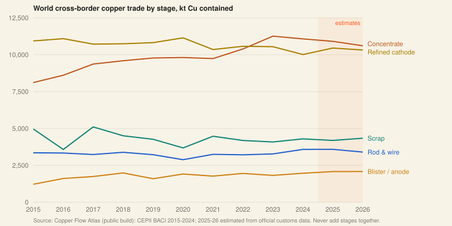

## Summary

Copper crosses borders several times on its way from mine to wire: as concentrate, as blister or anode, as refined cathode, and as rod, sheet or scrap. The Copper Flow Atlas maps those cross-border flows by stage from 2015 to the latest available month. It keeps a traceable working behind every number: the source, the estimation method, and any correction applied.

This note sets out the method, the checks that support it, and its limits. The atlas itself is at [ronnieslab.systems/atlas](https://ronnieslab.systems/atlas). In the atlas, click any lane to see its working.

## 1. Question

Where does the world's copper physically go between mine and wire? Who adds value at each stage? What changed in 2025–26, as U.S. tariff policy, mine outages and collapsing smelter fees moved the market?

## 2. Data

- **Backbone.** CEPII BACI (HS 2012 edition, release V202601) for 2015–2024. It reconciles exporters' and importers' customs declarations into one figure per pair and product.
- **Products.** Eleven forms from HS codes: concentrate (2603), residues, matte, blister and anode, refined cathode, alloy ingot, scrap, rod and wire, sheet/tube/foil, alloy semis, and winding wire.
- **Recent months.** Official customs data, one source per reporting country, in this order: Eurostat Comext (all EU members), the U.S. Census Bureau, Chile's customs export declarations, Peru's SUNAT exports by destination, then UN Comtrade.
  - Peru's months enter only once SUNAT's total is at least 85% of the central bank's (BCRP) total for that month.
  - China no longer reports monthly by partner. Its year-to-date totals from the General Administration of Customs (preliminary release, table 6) calibrate the current-year estimate of its imports.
- **Production and prices.** USGS Mineral Commodity Summaries (mine and refinery output by country). The World Bank Pink Sheet (monthly LME copper price). Annual benchmark treatment and refining charges.
- **Facilities.** The open mine production database (Jasansky et al. 2023, data to about 2021), plus curated smelters, refineries and newer mines.

## 3. Copper content

Customs records gross weight, not copper.

- **Refined and fabricated forms** use near-pure copper shares.
- **Scrap and alloys** use stated assumptions with ranges.
- **Concentrate grade** is estimated, per exporter and year:
  1. It is inferred from the customs value per tonne, the copper price, and that year's benchmark treatment and refining charges, assuming 96.5% payable copper and 8% moisture.
  2. Gold and silver credits inflate value, so the inferred grade is blended 50/50 with a 26% default.
  3. For mining countries, the grade is capped so that exports never contain more copper than USGS says was mined.
  4. The grade is dry, and customs weights are wet. Copper is therefore gross weight × grade × (1 − moisture).
- **Declared grades.** Where a country declares grades, the atlas uses them. Chile's customs lines state each shipment's copper grade and moisture.

**Broken quantities** are re-derived from value and tagged *derived*. 27,494 BACI rows ($16.6 bn of trade over 2015–2024) were corrected this way. Two checks catch them:

- **Unit value too low.** A row priced below a tenth of its product's median value per tonne. Papua New Guinea's 2019–22 concentrate rows reported roughly 100 times the tonnage its mines produce.
- **Below the copper price.** A near-pure form priced below 60% of the LME price. Zambia's 2016–17 blister rows were priced at about half of LME.

## 4. Estimating 2025 and the current year

Each exporter–importer–product pair starts from its 2024 BACI level. That level then moves with the official data the pair's reporting country publishes:

- **The reporter's 2024 value is within 1.5× of BACI's.** Its growth ratio is applied, capped at 10×.
- **The reporter sees more than BACI.** Its growth ratio is applied with a tighter 3× cap.
- **The reporter sees less than BACI.** Partial coverage: its change in tonnes is added instead. Australia reported only five months of 2024 concentrate exports to China, as shipments restarted.
- **The reporter is more than 4× away from BACI.** Its figures cover a different slice of trade and are ignored.
- **An annual report covers both 2024 and 2025.** It replaces annualised UN Comtrade months.
- **No monthly data at all.** Countries such as the DRC and Zambia follow their own USGS production change (mine output for concentrate, matte and blister; refined output for cathode). Pairs with nothing are carried forward. Values follow the copper price.
- **The current year.** It moves the 2025 estimate by the year-to-date change against the same months of 2025, from a monthly reporter that passes the same checks.

## 5. Checks

| Check | Atlas | Reference |
|---|---:|---:|
| China concentrate imports 2023, Mt gross | 27.8 | 27.54 (China customs) |
| China concentrate imports 2025, Mt gross (full pipeline) | 30.6 | 30.4 (China's annual report) |
| Chile concentrate grade 2024, copper share of wet weight | 25.7% value-based | 23.2% declared |
| China concentrate imports, Jan–Sep 2026 vs 2025 | calibrated | −2.9% by weight (GACC) |

**Chile.** The Chilean comparison changed the method. Against Chile's own declarations, the value-based grade overstated copper by about 10%. That led to two changes: declared grades are used where they exist, and Chile's earlier years are scaled by the same ratio so the series has no break.

**Year-on-year.** The pipeline's tests require that world trade in concentrate, blister, refined cathode, and rod and wire never moves by more than 40% from one year to the next. Large jumps are treated as data errors and investigated.

## 6. Routes and scenarios

**Routes** are simulated:

- Sea lanes run between main copper ports on a maritime network (searoute), avoiding the Red Sea from 2024.
- Neighbouring countries trade overland.
- DRC and Zambian exports split across rail and road corridors to Lobito, Dar es Salaam, Durban, Walvis Bay and Beira, using assumed shares.
- Each sea route records the chokepoints it passes, and its detour if each one closes.
- Copperbelt sales booked to trading hubs (Switzerland, Singapore, Hong Kong and others) are drawn as paperwork, not as routes.

**Scenarios** are transparent reallocations of one year's flows, not forecasts. Each one shows its assumptions.

- **U.S. duty on refined copper.** Imports fall 1.2× the duty rate; displaced cathode goes to each exporter's other buyers.
- **Lobito share.** The Lobito corridor's share of DRC and Zambian exports.
- **China smelter cut.** Other smelters can take at most 25% more; China replaces lost output with cathode imports.
- **Facility outage.** A mine's lost copper comes out of concentrate exports in proportion, then metal exports. A smelter stops needing imported feed.
- **Chokepoint closure.** Panama, Malacca, Suez/Red Sea or Hormuz: ships detour, or stop where there is no way round.

## 7. Limits

- **Copper content** of concentrate and scrap is estimated. The declared-grade correction exists only for Chile.
- **2025–26 rest on partial reporting.** China reports no monthly partner detail, and Peru's latest months lag.
- **Ownership** comes from records that end around 2021, and some owners have changed since.
- **Routes, parcels and corridor shares** are simulated.
- **Merchanted flows** through trading hubs are paperwork, and the physical cargo's route is unknown.
- **Never add stages together.** The same copper crosses borders as concentrate, then as cathode, then as rod.

## 8. Public atlas and full pipeline

The public atlas uses only redistributable sources: BACI, Eurostat, U.S. Census, USGS, the World Bank, the open mine database, Natural Earth, Chile's customs data, and the BCRP and GACC totals.

Some estimates depend on UN Comtrade or SUNAT, whose terms do not clearly allow republication. In the public atlas they fall back to the 2024 level, scaled by the exporter's USGS production change, and none of those sources' figures appear. Its 2025–26 lanes are therefore simpler than the full pipeline's. For example, the public atlas shows world concentrate trade of 10.9 Mt of copper in 2025, against 11.4 Mt in the full pipeline.

Research only, not financial advice. This note, its tables and figures are licensed CC BY 4.0; the source data keep their own licences.

## Sources

CEPII BACI (Etalab Open Licence 2.0). Eurostat Comext (Eurostat reuse policy). U.S. Census Bureau international trade API (public domain). Chile Servicio Nacional de Aduanas, export declarations via datos.gob.cl (ODC-BY). Banco Central de Reserva del Perú statistics. China General Administration of Customs, preliminary release. USGS Mineral Commodity Summaries (public domain). World Bank Commodity Price Data (CC BY 4.0). Jasansky et al. (2023), open database on global coal and metal mine production (CC BY 4.0). Natural Earth (public domain). searoute (Apache-2.0). In the full pipeline only: UN Comtrade and Peru SUNAT table G8. The full list with licences is in `evidence/sources.csv`.
